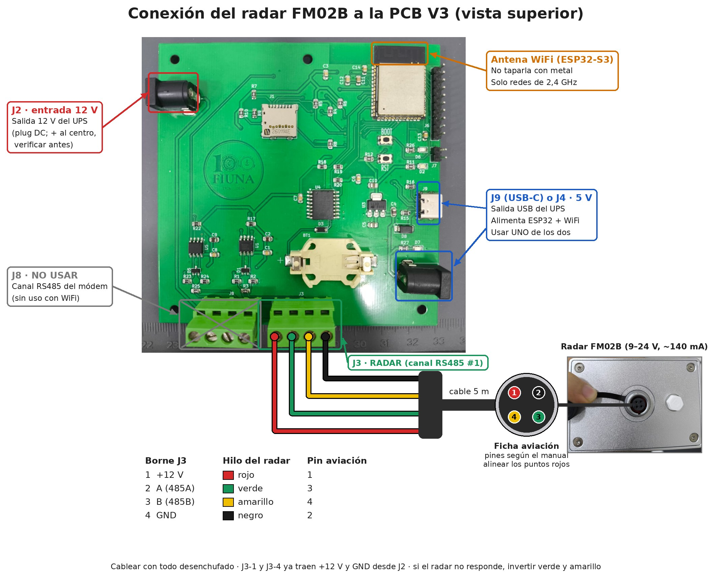

# Guía de conexión e instalación del radar FM02B (P4)

Guía práctica para armar la estación con el radar Luda/POLIVIR FM02B y la PCB V3. Los datos salen por dos caminos: el **módem DTU GPRS** (bornera J8) lleva cada medición al servidor PHP, y el **WiFi del ESP32-S3** la lleva a la PC del equipo y a la página de monitoreo (y es el respaldo del módem).

Fuentes: los tres PDFs de esta carpeta (ficha del LDFM02_B, protocolo Modbus V3 e instrucciones de montaje), el PCB `Hardware/V3_Estacion_Nivel/Estacion_Nivel_V3.kicad_pcb` y las fotos de `Fotos/`.

> **Ojo:** el PDF `Hardware/V3_Estacion_Nivel/planos/Estacion_Nivel_V3.pdf` y el BOM `Estacion_Nivel_V3.csv` están **desactualizados**: muestran borneras J4/J5 de 2 polos que la placa fabricada no tiene. Esta guía sigue el `.kicad_pcb` y el esquemático fuente (`vcc_to_3v3.kicad_sch`), que coinciden con la placa real.

> Los PDFs llaman al equipo LDFM01, LDFM02_B o LDFM04_B según el documento. Para la conexión no cambia nada: los 4 hilos y el protocolo son los mismos.

---

## 1. Qué se conecta con qué



### Conectores de la placa (vista superior, como en la foto)

| Conector | Dónde está | Qué es | Uso |
| -------- | ---------------- | ------------------------------ | ----------------------------- |
| **J2** | Jack DC arriba a la izquierda | Entrada **12 V** | Salida 12 V del UPS |
| **J9** | USB-C a la derecha | Entrada **5 V** (pasa por el diodo D8) | Salida USB del UPS (y programación) |
| **J4** | Jack DC abajo a la derecha | Entrada **5 V** directa (sin diodo) | Alternativa a J9: usar **uno solo** |
| **J3** | Bornera de 4, la de la **derecha** | Canal RS485 #1 (U1 → UART1) + 12 V | **Radar** |
| **J8** | Bornera de 4, la de la izquierda | Canal RS485 #2 (U5 → UART2) + 12 V | **Módem DTU GPRS** |

Las borneras se numeran **de izquierda a derecha** (borne 1 a la izquierda) mirando la placa como en la foto:

| Borne | J3 (radar) | J8 (módem DTU) |
| --- | --- | --- |
| 1 | +12 V | +12 V |
| 2 | A1 | A2 |
| 3 | B1 | B2 |
| 4 | GND | GND |

### Tabla de cableado del radar

| Hilo del radar | Pin aviación | Señal | Borne de la PCB | Notas |
| -------- | ------- | ---------- | -------------- | ----------------------------- |
| Rojo | 1 | Vcc 9–24 V | **J3-1** | +12 V que entran por J2 |
| Verde | 3 | 485A | **J3-2 (A1)** | Va al pin A del SP3485 (U1) |
| Amarillo | 4 | 485B | **J3-3 (B1)** | Va al pin B del SP3485 (U1) |
| Negro | 2 | GND | **J3-4** | Une la masa del radar con la de la PCB: **obligatorio** para el RS485 |

Lo que ya trae la PCB en el canal de J3 (no hay que agregar nada):

- Transceptor **SP3485EN a 3,3 V** (U1) → UART1 del ESP32: TX = GPIO1, RX = GPIO2, DE/RE = GPIO4.
- Resistencia de terminación de **120 Ω** (R3) entre A1 y B1.
- Polarización: 4,7 kΩ de A1 a 3,3 V (R1) y 4,7 kΩ de B1 a GND (R2).
- Protección TVS **SM712** (D1) en A1/B1.

### Cableado del módem DTU (USR-GPRS232-730)

| Módem | Borne de la PCB | Notas |
| --- | --- | --- |
| A | **J8-2 (A2)** | Va al SP3485 U5 → UART2 (TX GPIO5, RX GPIO6, DE/RE GPIO7) |
| B | **J8-3 (B2)** | A con A y B con B, sin cruzar |
| GND | **J8-4** | Recomendado: masa común con la placa |
| 12 V | fuente aparte (o J8-1) | Probado el 20/11/2026 con la alimentación del módem aparte |

- El módem tiene que tener la **antena** y el **chip** (Tigo, APN `internet.tigo.py`).
- Su configuración (modo HTTP client, URL, servidor) se hace una vez por comandos AT desde la PC, con un adaptador USB y el programa `Software/Moden/USR-GM3-Setup-Software_V1.2.1.101.exe` o con un script. El detalle está en `Software/CLAUDE.md`.

### Alimentación

- Radar: 9–24 V, típico **12 V a 130–160 mA** (~1,9 W); **medido: 126 mA a 12 V (~1,5 W)**. **No tiene modo de reposo**: consume eso todo el tiempo, también entre mediciones (para la autonomía con la UPS hay que contarlo así). Los manuales piden que en los bornes del radar haya **al menos 7 V**. Con los 5 m de cable que trae no hay problema, pero si se alarga el cable hay que medirlo.
- Los **12 V entran por el jack J2** y llegan directo a J3-1 y J8-1. **No alimentan al ESP32.**
- El ESP32 se alimenta con **5 V por J9 (USB-C) o por J4**, que van al AMS1117 → 3,3 V. Por eso hay que conectar **las dos** salidas del UPS: 12 V a J2 y 5 V a J9 o J4.
- **Polaridad de J2:** antes de enchufar, medir que el **centro del plug** del UPS sea el **+**. Con la placa sin alimentar, el pin central del jack J2 tiene que dar continuidad con J3-1.
- El WiFi del ESP32 tiene picos de ~350–500 mA en 3,3 V: usar una salida USB del UPS de al menos 1 A y un cable corto y bueno.

---

## 2. Antes de armar: probar el radar solo (recomendado)

Así se descartan problemas del sensor antes de sumar la PCB.

### Opción A: Bluetooth (sin cables de datos)

1. Alimentar el radar con 12 V (rojo +, negro −).
2. En WeChat, buscar el mini-programa **"JET Radar Debugger"** → `BR2262e-s` → **Flowmeter** → *Device Information* / *Parameter Configuration*.
3. Comprobar que muestra distancia y anotar la **dirección (debe ser 1)** y el **baud rate (debe ser 115200)**.

> **Hecho (19/11/2026):** con el Bluetooth se leyó **dirección 1** y **115200 baudios**. Coincide con la configuración del firmware, así que no hay que cambiar nada. La opción B ya no hace falta salvo para diagnosticar fallas.

#### Configuración leída con la app (19/11/2026)

Capturas en `Fotos/Aplicacion/`. Equipo: *flowmeter*, n.º de serie `1a91000400000019`, versión V25.

| Grupo | Parámetro | Valor | Comentario |
| ---------- | ---------------------- | ------------ | ----------------------------------------- |
| Básico | Dirección / baud | 1 / 115200 | Coincide con el firmware. **No tocar.** |
| Nivel | Rango (*Distance*) | 40 m | El máximo. Bien. |
| Nivel | Altura de instalación | 500 cm | Solo sirve para el "nivel" que calcula el radar (5,00 − d). El firmware usa `d`, así que no influye. |
| Nivel | **Calibración** | **−46 mm** | Corrimiento que el radar resta a todas las distancias. No cambiarlo a ciegas: ver abajo. |
| Nivel | Sensibilidad | 5 | El manual dice 3 de fábrica (menor = más sensible). |
| Nivel | Potencia de emisión | 7 | **La mínima** (0 = máxima). |
| Velocidad | Filtro de sentido, algoritmo espectral, límite | bidireccional, apagado, 5 m/s | El caudal está fuera de alcance: dejarlo así. |
| Lectura | Distancia (*Empty height*) | 0,849 m | Nivel = 5,000 − 0,849 = 4,151 m (coincide). |
| Lectura | **Señal de nivel** | **4** | Muy baja: el manual pide más de 30 dB. |
| Lectura | Ángulo | 56,1° | Cercano a los 55° nominales del haz de velocidad. |

Qué hacer con estos valores:

1. **Señal de nivel = 4.** Una lectura con tan poca señal puede no ser confiable. Primero hay que ver cuánto da apuntando al agua del balde, a ~1 m, sin objetos cerca (la captura puede haber sido apuntando a la mesa o al piso). Si sigue baja, subir la **potencia de emisión de nivel** (7 → 3, o hasta 0) y volver a mirar la señal. Se cambia desde la app o por Modbus con el registro `0x07D7` (tramas en la sección 5). La señal también aparece en el monitor serie del firmware.
2. **Calibración −46 mm.** No se sabe si viene de fábrica o la cambió alguien. En el banco, comparar la distancia del radar con la cinta métrica a 3–4 alturas de agua:
   - si la diferencia es **constante**, corregirla en este parámetro (registro `0x07D8`, en pasos de 1 mm) y anotar el valor anterior y el nuevo;
   - si la diferencia **varía** con la altura, no es un problema de corrimiento: revisar la nivelación y el haz.
3. **Ángulo 56,1°.** Según la figura del manual, con el radar nivelado el haz de velocidad queda a 55°. Es probable que esta lectura sirva para verificar la nivelación (≈ 55° = nivelado), pero hay que **confirmarlo una vez** con el nivel de burbuja antes de usarlo.
4. **Altura de instalación.** Opcional: ponerla igual a la altura real del banco (en cm), así la app muestra el nivel del agua directamente y se puede comparar con la cinta.

### Opción B: adaptador USB–RS485 en la PC

Conectar verde → A, amarillo → B, negro → GND del adaptador (y 12 V aparte). Configuración: **115200 baudios, 8N1, sin paridad, dirección 1**.

Script mínimo (Linux, `pip install pyserial`); las tramas son las del manual y tienen el CRC verificado:

```python
import serial, time
s = serial.Serial("/dev/ttyUSB0", 115200, timeout=0.5)
def q(hexstr):
    s.reset_input_buffer(); s.write(bytes.fromhex(hexstr)); time.sleep(0.1)
    r = s.read(64); print(hexstr, "->", r.hex(" ").upper()); return r
r = q("01 03 00 01 00 01 D5 CA")             # distancia, mm
if len(r) >= 5: print("d =", int.from_bytes(r[3:5], "big"), "mm")
r = q("01 03 00 04 00 01 C5 CB")             # intensidad de señal, dB (>30 = buena)
if len(r) >= 5: print("señal =", int.from_bytes(r[3:5], "big"), "dB")
```

Si no responde nada: invertir verde y amarillo (no rompe nada) y revisar que el GND esté unido.

---

## 3. Armado paso a paso (con todo desenchufado)

1. **Desconectar el UPS.** Todo el cableado se hace sin tensión.
2. **Radar a J3** (la bornera de 4 de la derecha), de izquierda a derecha:
   - J3-1 ← **rojo**, J3-2 ← **verde**, J3-3 ← **amarillo**, J3-4 ← **negro**.
   - Usar punteras (terminales tubulares) en los hilos y ajustar bien los tornillos de la bornera de 5 mm.
   - La bornera es enchufable: se puede sacar de la placa para cablearla más cómodo y después volver a enchufarla.
3. **Conector de aviación** (radar ↔ cable): alinear los **puntos rojos** de las dos partes, sostener por la zona "1" del dibujo del manual y empujar hasta oír el **"clic"**. Para sacarlo, tirar sujetando por la zona "2" (no tirar del cable).
4. **Revisión con el multímetro, todavía sin tensión:**
   - no hay continuidad entre J3-1 (+12 V) y J3-4 (GND);
   - el pin central de J2 da continuidad con J3-1, y la carcasa de J2 con J3-4;
   - entre J3-2 y J3-3 se miden ~120 Ω (la terminación de la placa; con el radar conectado puede dar algo menos).
5. **12 V a la placa:** enchufar el plug de 12 V del UPS en **J2**, con la polaridad ya verificada (+ al centro).
6. **5 V a la placa:** cable USB del UPS a **J9 (USB-C)**. Si se usa J4 en su lugar, no conectar los dos al mismo tiempo.
7. **Encender** y medir **≥ 7 V entre rojo y negro del lado del radar** (debería dar ~12 V).
8. Abrir el monitor serie (`pio device monitor -b 115200`) y comprobar que el firmware lee la distancia y la señal (ver la sección 6).

---

## 4. Montaje mecánico (banco de laboratorio)

### Kit que trae el radar

- **Soporte "pico de pato"** (duckbill), orientable, en acero inoxidable.
- **Placa adaptadora** de 110 × 93 mm con ranuras para abrazaderas y agujeros de Ø 7 mm.
- **3 abrazaderas** inoxidables, para fijarlo a un poste o caño.
- El cuerpo del radar mide ~159,5 × 95 × 99 mm. La **cara de arriba es plana** y tiene los agujeros de fijación al soporte. La **antena de nivel (80 GHz) mira hacia abajo**. La **cara inclinada a 35°** es la de la antena de velocidad (24 GHz).

### Reglas del manual que aplican al banco

1. **Antena de nivel perpendicular al agua (90°).** El manual marca como **incorrecto** montarlo inclinado. Para nivelarlo, apoyar un **nivel de burbuja sobre la cara superior plana** y comprobarlo en los dos ejes; después, ajustar el soporte orientable.
   - Ayuda extra: los registros `0x0009` (roll) y `0x000A` (pitch), en 0,1°, salen del giróscopo interno. Con el radar ya nivelado con burbuja, leerlos y **anotarlos como referencia**: sirven para comprobar más tarde que no se movió.
2. **Huella del haz de nivel** (elipse sobre el agua, con H = altura de la antena en metros):
   - ancho C ≈ **0,25·H** (haz de 14°) × D ≈ **0,17·H** (haz de 10°).
   - Para que el haz **no toque las paredes del balde**, C tiene que entrar dentro del diámetro. Con un balde de 30 cm: 0,25·H ≤ 0,30 → **H ≤ 1,2 m**, así que conviene quedarse en ~1 m.
   - Rango mínimo: **0,1 m**. No acercar el agua a menos de 10 cm de la antena.
3. **Haz de velocidad:** sale hacia adelante, a 55° de la horizontal, e incide a L ≈ 0,7·H. En el banco no hay corriente, así que la velocidad va a dar ~0 o ruido. Eso es normal y no afecta la medición de nivel.
4. **Cable:** dejar un **bucle en "U"** por debajo del conector (gotero), para que el agua no escurra hacia la ficha. El manual recomienda **caño corrugado** para el cable. No dejar el peso del cable colgando del conector.

### Pruebas en interior (avisos del manual)

Los tubos fluorescentes, los ventiladores, la salida del aire acondicionado, las fuentes de potencia y los objetos metálicos cerca del haz generan **lecturas espurias** por reflexión múltiple, sobre todo en la velocidad. Para el banco:

- sacar objetos metálicos del cono de la antena (soportes, reglas, mesas);
- si aparecen saltos raros, apagar el ventilador o el aire, o hacer la prueba junto a una ventana abierta;
- controlar la **intensidad de señal** (registro `0x0004`): por encima de **30 dB** es buena.

---

## 5. Registros Modbus útiles (resumen del protocolo V3)

Formato: **115200 8N1, dirección 1, función 03 (leer) / 06 (escribir 1 registro), CRC16 Modbus (polinomio A001)**. Los enteros vienen en big-endian. Los `float` de 4 bytes vienen en **little-endian (DCBA)**: hay que invertir el orden de los bytes antes de convertir.

| Registro | Qué es | Trama de lectura | Formato |
| ----------- | ------------------- | ------------------------------- | ------------------- |
| `0x0001` | **Distancia radar → agua** (filtrada) | `01 03 00 01 00 01 D5 CA` | uint16, **mm** |
| `0x0003` | Nivel de agua = alt. instalación − distancia | `01 03 00 03 00 01 74 0A` | uint16, mm |
| `0x0004` | Intensidad de señal (nivel) | `01 03 00 04 00 01 C5 CB` | dB, > 30 = buena |
| `0x0005` | Altura de instalación (R/W) | `01 03 00 05 00 01 94 0B` | uint16, **cm** (fábrica: 10 000 cm) |
| `0x0009` / `0x000A` | Roll / pitch | `01 03 00 09 00 01 54 08` / `01 03 00 0A 00 01 A4 08` | int16, 0,1° |
| `0x01F4–F5` | Velocidad filtrada | `01 03 01 F4 00 02 84 05` | int32 BE con signo, **× 0,001 m/s** |
| `0x000F–10` | Velocidad superficial | `01 03 00 0F 00 02 F4 08` | float LE, m/s |
| `0x006E` | Dirección del equipo | `01 03 00 6E 00 01 E5 D7` | fábrica 1 |
| `0x006F` | Baud rate / 100 | `01 03 00 6F 00 01 B4 17` | en nuestro radar: 115200 |
| `0x07D7` | Potencia de emisión de nivel (R/W) | `01 03 07 D7 00 01 35 46` | 0 = máxima … 7 = mínima (la nuestra: 7) |
| `0x07D8` | Calibración de distancia (R/W) | `01 03 07 D8 00 01 05 45` | pasos de 1 mm (la nuestra: −46 mm) |
| `0x07D9` | Sensibilidad de nivel (R/W) | `01 03 07 D9 00 01 54 85` | menor = más sensible (la nuestra: 5; fábrica 3) |
| `0xEA60–63` | Identificación del equipo | `01 03 EA 60 00 04 70 0F` | `0xEA60` = `0x1A91`, el inicio del n.º de serie (`1a91000400000019`) |

Notas:

- **Para el proyecto alcanza con `0x0001`** (la distancia `d`). El firmware envía `d` crudo: `Nivel = H − d` no se calcula en la placa. Los registros `0x0003`/`0x0005` son opcionales.
- Si alguna vez se quiere usar `0x0003`: primero escribir la altura de instalación en cm. Ejemplo para 100 cm: `01 06 00 05 00 64 98 20`.
- La tabla del manual dice que el baud de fábrica es `0x60` (9600), pero **nuestro radar está a 115200** (confirmado por Bluetooth el 19/11/2026), igual que dice la ficha.
- La respuesta a una lectura de 1 registro tiene 7 bytes: `01 03 02 HH LL CRC CRC`.
- **No escribir** registros de flujo, sección o algoritmo (`0x0061–0x0066`, `0x07E2`…): no hacen falta para medir nivel.
- **Escribir la potencia de nivel** (función 06, CRC verificado): 7 → `01 06 07 D7 00 07 79 44` · 3 → `01 06 07 D7 00 03 78 87` · 0 → `01 06 07 D7 00 00 38 86`. El radar responde con la misma trama si la aceptó. Leer el registro antes y después, y anotar los dos valores.
- **Calibración y sensibilidad** también se escriben con la función 06, pero antes de escribirlas hay que **leerlas** para confirmar cómo codifica el radar el valor (la calibración es negativa). Si hay dudas, usar la app.
- El radar promedia con un **filtro de 128 muestras**: después de encenderlo o de cambiar un parámetro, tarda un rato en dar un valor estable. Por eso el firmware hace una lectura de descarte al arrancar y reintenta hasta 3 veces.
- **No hay registro de temperatura.**
- El manual dice que los registros "están en decimal", pero las tramas de ejemplo están en hexadecimal y son las que funcionan (`0x0001`, no `1` decimal convertido).

---

## 6. Firmware (`Software/Firmware_Final`)

El firmware está **probado en la placa** con el radar (19/11/2026) y con el módem y el WiFi juntos (20/11/2026). El detalle técnico está en `Software/CLAUDE.md`.

### Sensor (`components/sensor_rs485/sensor_rs485.c`)

| Antes (ultrasónico P3) | Ahora (radar FM02B) |
| --- | --- |
| 9600 baudios | **115200** (`SENSOR_BAUD_RATE`) |
| Registro 0x0000 | **0x0001** (distancia, mm → m), **0x0004** (señal) y **0x01F4–F5** (velocidad) |
| DE/RE (GPIO4) manejado a mano con retardos | DE/RE manejado **por hardware** (modo RS485 half-duplex del UART) |
| Sin verificar el CRC | **Se verifica el CRC**, la dirección, la función y la cantidad de bytes; detecta excepciones Modbus |
| — | Estado de cada lectura: 0 OK, 1 sin respuesta, 2 respuesta inválida, 3 fuera de rango (< 100 mm) |

Los pines **no cambian** (GPIO1/2/4, UART1, bornera J3).

### A dónde va cada medición (cada 5 min)

| Destino | Por dónde | Qué va | Si falla |
| --- | --- | --- | --- |
| microSD `datos.csv` | — | línea completa: epoch, id, distancia (m), velocidad (m/s), señal (dB), estado | — |
| Servidor PHP (`insertarMasi.php`) | **Módem GPRS** (J8) | `d=<epoch>,<distancia>` (`-1` si el radar falló) | se reintenta por **WiFi**; si también falla, queda en `temp.csv` y la tarea de pendientes lo reenvía |
| PC del equipo | WiFi, UDP broadcast, puerto 5005 | la misma línea de `datos.csv` | queda solo en la SD |
| Página de monitoreo (GitHub Pages) | WiFi, HTTPS | la misma línea de `datos.csv` | queda en la SD y en la PC |

- El servidor solo acepta los 2 campos de `d=`: la velocidad y la señal van a la SD, la PC y la página.
- Página: https://hecvelaz.github.io/Sistema-de-adquisicion-y-monitoreo-de-nivel-P4/
- Receptor en la PC: `python3 Software/receptor_pc/receptor_udp.py` (guarda `lecturas_pc.csv`). En Linux hay que abrir el puerto: `sudo ufw allow 5005/udp`.
- **Modo banco** (`PLATFORMIO_BUILD_FLAGS=-DMODO_BANCO pio run -t upload`): lee el radar cada 2 s y lo manda solo a la PC. Es el modo para las pruebas de exactitud. Para volver al normal, cargar sin flags.

### Lo que hay que completar antes de cargar

Editar **`Software/Firmware_Final/components/wifi_envio/credenciales.h`**. Este archivo **no se sube al repo** (está en `.gitignore`); la plantilla es `credenciales_ejemplo.h`.

```c
#define WIFI_REDES { \
    { "red_preferida", "clave_1" }, \
    { "red_de_respaldo", "clave_2" }, \
}
#define SERVIDOR_URL "http://<IP del servidor>/level/insertarMasi.php"   // sin "?d=..."
#define PC_IP        "255.255.255.255"                                 // broadcast a la PC
#define PC_PUERTO    5005
#define GITHUB_REPO  "HecVelaz/Sistema-de-adquisicion-y-monitoreo-de-nivel-P4"
#define GITHUB_TOKEN "github_pat_..."   // token fine-grained, solo este repo, Contents: Read and write
```

- La placa usa la primera red de la lista que encuentra; si una falla 3 veces seguidas, pasa a la siguiente.
- **La IP del servidor, las claves y el token no se escriben en el repo ni en esta guía.** Se pasan por un canal privado del equipo. El token vence (el actual, el 19/01/2027): al vencer, la página deja de recibir datos hasta cargar uno nuevo.
- Después: `pio run -t upload` y `pio device monitor -b 115200`. En el monitor tienen que verse `Conectado a "<red>"`, `Distancia: x.xxx m | senal: NN dB | velocidad: ...`, `Respuesta DTU: OK` y `GitHub: lectura enviada a la pagina`.
- Con la placa conectada al USB de la PC, después de cargar puede quedar en `waiting for download`: apretar **RESET**.

### Cosas del WiFi a tener en cuenta en el lugar

- El ESP32-S3 solo usa **2,4 GHz**.
- Las redes con **portal cautivo** (página de login) no funcionan con el ESP32. FIUNA (WPA2) funciona; para el banco también sirve el hotspot de un celular.
- El módulo WROOM-1 tiene **antena impresa**: una **caja metálica la bloquea**. Mirar el RSSI que muestra el monitor serie (mejor que −70 dBm) en el lugar definitivo.
- Para que la PC reciba por broadcast, tiene que estar en la **misma red** que la placa.

---

## 7. Lista de verificación rápida

- [ ] Radar probado solo (Bluetooth o USB–RS485): responde en la dirección 1; baud confirmado.
- [ ] UPS desconectado durante el cableado.
- [ ] J3 (bornera derecha), de izquierda a derecha: rojo, verde, amarillo, negro.
- [ ] Módem en J8: A → J8-2, B → J8-3, GND → J8-4; módem con 12 V, antena y chip.
- [ ] 12 V del UPS → jack J2 (+ al centro, verificado); 5 V → USB-C J9 (o J4, nunca los dos).
- [ ] Sin corto entre J3-1 y J3-4; entre J3-2 y J3-3 hay ~120 Ω.
- [ ] Conector de aviación con los puntos rojos alineados y el "clic".
- [ ] ≥ 7 V en los bornes del radar.
- [ ] Antena nivelada con burbuja (los dos ejes); roll/pitch anotados.
- [ ] Haz dentro del balde (H ≤ ~1,2 m con balde de 30 cm; agua a más de 10 cm).
- [ ] Sin metal ni ventiladores en el cono; señal `0x0004` > 30 dB.
- [ ] Cable con bucle en "U" y sin peso sobre el conector.
- [ ] `credenciales.h` completado (redes WiFi, URL, PC, token) y **no subido** al repo.
- [ ] Firmware cargado; el monitor muestra la distancia, la señal, `Respuesta DTU: OK` y `GitHub: lectura enviada a la pagina`.

## 8. Si algo falla

| Síntoma | Causa probable | Qué hacer |
| ------------------ | ------------------- | ----------------------- |
| No hay ninguna respuesta Modbus | A/B invertidos, GND sin unir, baud mal | Invertir verde/amarillo; revisar negro → J3-4 |
| Responde con CRC malo o basura | Ruido o mal contacto | Revisar las borneras y el GND; acortar el cable |
| Distancia que salta o es absurda | Haz tocando la pared del balde, metal o ventilador cerca, antena inclinada | Bajar H, centrar, nivelar, revisar la señal `0x0004` |
| El radar se reinicia o no prende | Tensión < 7 V en sus bornes | Medir en el lado del radar; revisar la salida de 12 V del UPS |
| La placa se reinicia al transmitir por WiFi | USB flojo o débil | Cable USB-C corto; salida ≥ 1 A |
| No conecta al WiFi | Portal cautivo, 5 GHz o caja metálica | Usar una red WPA2 de 2,4 GHz; mejorar la ubicación de la antena |
| `HTTP 404/405` o sin `OK` | URL mal escrita, o el servidor no responde `OK` | Revisar `SERVIDOR_URL`; ver en el monitor la respuesta que devuelve el servidor |
| `Sin respuesta del DTU` | A/B invertidos o sueltos en J8, módem sin 12 V, sin antena o sin señal | Revisar el cableado y la alimentación; consultar la señal con `AT+CSQ` desde la PC (> 15 de 31 es aceptable) |
| `Modem sin OK. Reintentando por WiFi` | El módem no recibió respuesta del servidor (GPRS caído, crédito, URL del módem) | Revisar la URL y el servidor configurados en el módem (`AT+HTPURL`, `AT+HTPSV`) |
| `GitHub: HTTP 401/403/404` | Token vencido, sin permiso Contents o sin el repo seleccionado | Editar o renovar el token en GitHub; si cambia, cargarlo en `credenciales.h` y recargar |
| La PC no recibe nada | Otra red, firewall, receptor cerrado | Misma red que la placa; `sudo ufw allow 5005/udp`; abrir `receptor_udp.py` |
| `waiting for download` tras cargar | Reinicio por USB en modo descarga | Apretar RESET |
